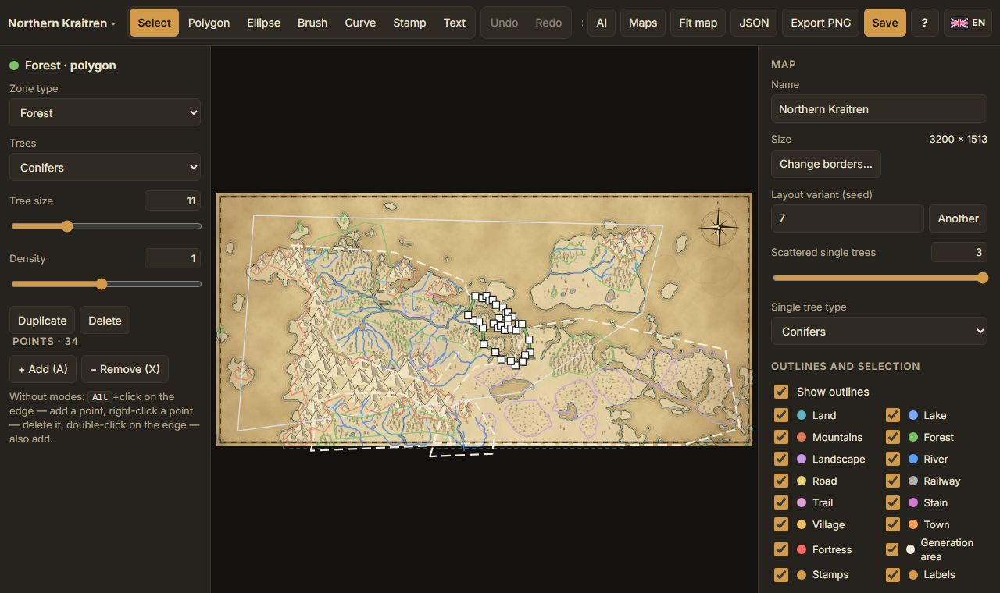

# Suzerain: Free Fantasy Map Editor · Сюзерен: Безкоштовний Редактор Фентезі Мап

**[▶ Open the editor · Відкрити редактор](https://olshenua.github.io/suzerain-map-editor/)**

[English](#english) · [Українська](#українська)

---

## English

**Suzerain** is a free fantasy map editor that runs right in your browser. Maps look like ink drawn on aged parchment — coastlines with ripples, hatched mountains, forests, rivers, villages and fortresses. Made for tabletop RPGs (D&D and others), worldbuilding and stories.

No sign-up, no download, no ads. Your maps stay on your computer.

### What you can do

- **Draw land and water** with a polygon, an ellipse or a brush. Coasts get smoothed and inked automatically.
- **Mountains, hills, forests** (conifers, broadleaf, mixed, palms, jungle, dead trees) and **landscapes**: snow, tundra, steppe, fields, marsh, desert.
- **Rivers, roads, railways and trails** that snap to each other, to lakes and to the coast.
- **Villages, towns and fortresses** that build themselves inside the area you outline — with houses, fields, walls and towers.
- **Stamps and labels**: compass rose, towers, ruins, caves, camps, banners and more, plus text in several fantasy fonts.
- **Generate** streams, ponds and marshes inside a chosen area.
- **Export to PNG** — the whole map or a selected part, in high quality.
- **Ask an AI to edit the map**: describe the change (“make this island bigger”, “add snow on the northern mountains”), copy the request into any AI chat (ChatGPT, Claude, Gemini…) and paste the answer back. You see the changes before / after and decide whether to keep them. No AI account inside the editor is needed.
- Interface in **English and Ukrainian** — switch any time with the flag in the top-right corner.

### Getting started

1. Open **[the editor](https://olshenua.github.io/suzerain-map-editor/)** and choose your language.
2. Pick a template: a blank sheet, an island, a coast, an inland province — or **Northern Kraitren**, an example map from the author’s D&D campaign “No Longer You”.
3. A short help window opens. You can always bring it back with the **?** button in the top-right corner (or F1).

A desktop browser works best: **Chrome or Edge** (Firefox and Safari work too). The editor can be used on a tablet, but a mouse makes drawing much easier.

### Where your maps are kept

- Every change is **saved automatically in your browser**. Nothing is uploaded anywhere.
- **Maps** (top bar) lists all your maps: open, rename, copy, delete.
- Browser storage can be wiped (clearing history, another browser or computer). For important maps press **Save** — it writes a `.json` file you can keep, back up and open again later (**Maps → Open file…**).

### Questions

**Is it really free?** Yes. The editor and its code are free and open source under the MIT license.

**Can I use my maps in my game, book or stream, also commercially?** Yes — the maps you make are yours.

**Does it work offline?** Once the page has loaded it works without internet; only the fonts come from the web.

**Something broke or I have an idea.** Open an [issue on GitHub](https://github.com/OlshenUA/suzerain-map-editor/issues).

---

## Українська

**Сюзерен** — безкоштовний редактор фентезі-мап, який працює просто в браузері. Мапи виглядають як чорнило на пожовклому пергаменті: узбережжя з брижами, заштриховані гори, ліси, річки, села й фортеці. Для настільних рольових ігор (D&D та інших), світотворення й історій.

Без реєстрації, без завантажень, без реклами. Ваші мапи залишаються на вашому комп’ютері.

### Що можна робити

- **Малювати сушу й воду** полігоном, овалом або пензлем. Береги згладжуються й обводяться чорнилом самі.
- **Гори, пагорби, ліси** (хвойні, листяні, мішані, пальми, джунглі, сухостій) і **ландшафт**: сніг, тундра, степ, поля, болото, пустеля.
- **Річки, дороги, залізниці й стежки**, що прилипають одна до одної, до озер і до берега.
- **Села, міста й фортеці** будуються самі всередині обведеної області — з хатами, полями, мурами й вежами.
- **Штампи й написи**: роза вітрів, вежі, руїни, печери, табори, стяги та інше, а також текст кількома фентезійними шрифтами.
- **Генерувати** струмки, озерця й болота у вибраній області.
- **Експорт у PNG** — уся мапа або вибрана частина, у високій якості.
- **Просити ШІ змінити мапу**: опишіть зміну («зроби цей острів більшим», «додай сніг на північних горах»), скопіюйте запит у будь-який чат ШІ (ChatGPT, Claude, Gemini…) і вставте відповідь назад. Ви побачите зміни «до / після» й вирішите, залишати їх чи ні. Обліковий запис ШІ в самому редакторі не потрібен.
- Інтерфейс **українською та англійською** — перемикається будь-коли прапорцем у правому верхньому куті.

### Як почати

1. Відкрийте **[редактор](https://olshenua.github.io/suzerain-map-editor/)** і оберіть мову.
2. Оберіть шаблон: чистий аркуш, острів, узбережжя, внутрішня провінція — або **Північ Крайтрену**, приклад мапи з D&D-кампанії автора «Уже не ви».
3. Відкриється коротка довідка. Її завжди можна відкрити знову кнопкою **?** у правому верхньому куті (або F1).

Найкраще працює в браузері на комп’ютері: **Chrome або Edge** (Firefox і Safari теж підходять). На планшеті редактор відкривається, але з мишкою малювати значно зручніше.

### Де зберігаються мапи

- Кожна зміна **автоматично зберігається у вашому браузері**. Нікуди нічого не відправляється.
- **Мапи** (верхня панель) — список усіх ваших мап: відкрити, перейменувати, копія, видалити.
- Сховище браузера можна випадково очистити (очищення історії, інший браузер чи комп’ютер). Важливі мапи зберігайте кнопкою **Зберегти** — вона записує файл `.json`, який можна тримати як резервну копію й відкрити пізніше (**Мапи → Відкрити файл…**).

### Питання

**Це справді безкоштовно?** Так. Редактор і його код безкоштовні й відкриті за ліцензією MIT.

**Чи можна використовувати мої мапи в грі, книжці чи на стрімі, зокрема комерційно?** Так — створені вами мапи належать вам.

**Чи працює без інтернету?** Після завантаження сторінки — так; з інтернету беруться лише шрифти.

**Щось зламалося або є ідея.** Створіть [issue на GitHub](https://github.com/OlshenUA/suzerain-map-editor/issues).

---

## For developers · Для розробників

A static site: plain HTML, CSS and JavaScript, no build step. To run it locally, serve the folder with any static server (`python -m http.server 8000` or `npx serve .`) and open `http://localhost:8000`.

- How the code is organised and the project conventions: [CLAUDE.md](CLAUDE.md) (Ukrainian).
- Map format for AI tools and agents: [AI.en.md](AI.en.md) · [AI.md](AI.md).
- Refreshing the help screenshots: [tools/help-shots.md](tools/help-shots.md).

License: [MIT](LICENSE).
